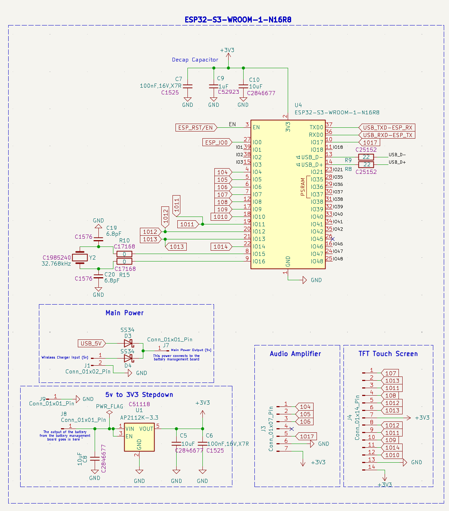
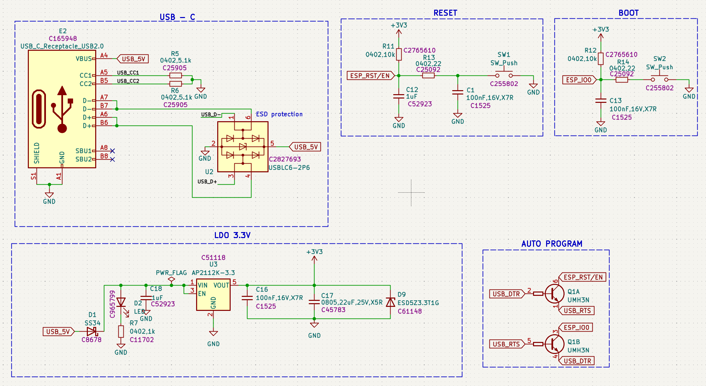

# MAGSAFE ESP32-S3 HUB
**Don't get up, just use this...**

## About My Project

What is my project? My project is one of a kind! I am using an ESP32-S3 microcontroller chip to power a smart 2.8" TFT touchscreen. As mentioned in the title, it is listed as being MagSafe compatible, which is ingenious, right? Who does not want to have it charging 24/7? Or maybe not? Well, that has been solved too! I have added a 3.7V 5000mAh LiPo battery that can last well over 24 hours. But that is not all! I have also included an audio amplifier with a super loud and crisp speaker so you can hear those alerts and alarms from meters away.

I’ve made this project because I am tired of opening my laptop just to have a look at the time, set a timer, turn on smart lights, or do almost anything else. With my design, I’ll be able to control these all in one. You can have it play soothing music or play annoying alarms whenever.

**How to use:**

Plug it into the dedicated USB-C port at the bottom side with a USB-C cable or any compatible iPhone MagSafe charger. Let it charge for 10 minutes to an hour to fully charge. For MagSafe, let it charge for 30 minutes to an hour and 15 minutes.

**Wiring Diagram:**

## Schematics
The schematics of my final design, what I'll be using to make the main PCB.

## PCB
The fully routed PCB, with fun easter egg and smart eletrical wiring choices that save money and change the path of electricity more efficiently.

N/A

## CAD
A full design of the parts (except some models impossible to source)

N/A

## BOM

| Part | Type | Quantity | Unit price (USD) | Line total (USD) | Link | Vendor | Funding | Notes | Reference | Footprint | Datasheet | MPN | LCSC |
|---|---|---|---|---|---|---|---|---|---|---|---|---|---|
| Shipping (JLCONE) | Shipping | 1 | 17.49 | 17.49 | [Link](https://jlcpcb.com/?from=VGS&utm_source=google&utm_medium=cpc&utm_campaign=14177189905&gad_source=1&gad_campaignid=14177189905&gbraid=0AAAAABS1QqkgPoFOHUy_26J4N5kBx4Aa3&gclid=Cj0KCQiAwdDXBhDuARIsAFdLukmN-B7r3FdQKI8Ma6WjcPEJgnZSJuI_80tu4TU9jCkDFhZ-cYRUD3oaAn0kEALw_wcB) | JLCPCB | Grant |  | N/A | N/A | N/A | N/A | N/A |
| Shipping (AliExpress) | Shipping | 1 | 2.03 | 2.03 | N/A | AliExpress | Grant |  | N/A | N/A | N/A | N/A | N/A |
| Tax (AliExpress) | Tax or fee | 1 | 1.74 | 1.74 | N/A | AliExpress | Grant |  | N/A | N/A | N/A | N/A | N/A |
| MAX98357A audio amplifier | Part | 1 | 2.07 | 2.07 | [Link](https://www.aliexpress.com/item/1005007003802663.html?spm=a2g0o.productlist.main.4.2bd23ce0doG6x8&aem_p4p_detail=202611050133081315319932123740002772996&algo_pvid=0ad6be40-46e3-4f00-9430-e9820924795f&algo_exp_id=0ad6be40-46e3-4f00-9430-e9820924795f-3&pdp_ext_f=%7B%22order%22%3A%223834%22%2C%22spu_best_type%22%3A%22price%22%2C%22eval%22%3A%221%22%2C%22fromPage%22%3A%22search%22%7D&pdp_npi=6%40dis%21AUD%212.99%212.84%21%21%2113.80%2113.11%21%402101ca9517938711880116699e0d41%2112000052658790894%21sea%21AU%212961347876%21X%211%210%21n_tag%3A-29919%3Bd%3A20f6a0d2%3Bm03_new_user%3A-29895%3BpisId%3A5000000220905999&curPageLogUid=gHNWoxg3Cup0&utparam-url=scene%3Asearch%7Cquery_from%3A%7Cx_object_id%3A1005007003802663%7C_p_origin_prod%3A&search_p4p_id=202611050133081315319932123740002772996_1) | AliExpress | Grant |  | MAX98357A | N/A | [Datasheet](https://www.analog.com/media/en/technical-documentation/data-sheets/MAX98357A-MAX98357B.pdf) | N/A | N/A |
| Wireless charger receiver | Part | 1 | 2.92 | 2.92 | [Link](https://www.aliexpress.com/item/1005006917890401.html?spm=a2g0o.productlist.main.21.5befc5e30wHdxF&algo_pvid=c3f727d4-7764-4de2-9cfe-4073aea75173&algo_exp_id=c3f727d4-7764-4de2-9cfe-4073aea75173-18&pdp_ext_f=%7B%22order%22%3A%22260%22%2C%22spu_best_type%22%3A%22price%22%2C%22eval%22%3A%221%22%2C%22fromPage%22%3A%22search%22%7D&pdp_npi=6%40dis%21AUD%213.98%213.49%21%21%212.75%212.41%21%402101d2e717938715347906588e0f1b%2112000038722150536%21sea%21AU%212961347876%21X%211%210%21n_tag%3A-29919%3Bd%3A20f6a0d2%3Bm03_new_user%3A-29895%3BpisId%3A5000000220770329&curPageLogUid=ptJgFovmIGzU&utparam-url=scene%3Asearch%7Cquery_from%3A%7Cx_object_id%3A1005006917890401%7C_p_origin_prod%3A) | AliExpress | Grant |  | 5W | N/A | N/A | N/A | N/A |
| Battery management board | Part | 1 | 0.80 | 0.80 | [Link](https://www.aliexpress.com/item/1005013472412754.html?spm=a2g0o.productlist.main.9.7fb4e999hY7Rre&algo_pvid=98fe2f10-0cd6-416a-bbd2-9b577de21ebe&algo_exp_id=98fe2f10-0cd6-416a-bbd2-9b577de21ebe-8&pdp_ext_f=%7B%22order%22%3A%225%22%2C%22spu_best_type%22%3A%22price%22%2C%22eval%22%3A%221%22%2C%22fromPage%22%3A%22search%22%7D&pdp_npi=6%40dis%21AUD%212.45%210.97%21%21%2111.31%214.51%21%402101d33417938729376868658e0dc7%2112000061234386246%21sea%21AU%212961347876%21X%211%210%21n_tag%3A-29919%3Bd%3A20f6a0d2%3Bm03_new_user%3A-29895%3BpisId%3A5000000220868114&curPageLogUid=SZ1nXcZwQJOj&utparam-url=scene%3Asearch%7Cquery_from%3A%7Cx_object_id%3A1005013472412754%7C_p_origin_prod%3A) | AliExpress | Grant |  | 1X-Type C | N/A | N/A | N/A | N/A |
| 5000mAh 955565 Lipo Lithium Battery | Part | 1 | 8.55 | 8.55 | [Link](https://www.aliexpress.com/item/1005012710344008.html?spm=a2g0o.detail.0.0.4f13zLNrzLNrYC&mp=1&pdp_npi=6%40dis%21AUD%21AUD+44.89%21AUD+12.70%21%21AUD+12.70%21%21%21%402101c69517948801902018396e0e59%2112000059134254104%21ct%21AU%212961347876%21%211%210%21) | AliExpress | Grant |  | 3.7 V | N/A | N/A | N/A | N/A |
| 2W Speaker | Part | 1 | 2.60 | 2.60 | [Link](https://www.aliexpress.com/item/1005007640238935.html?spm=a2g0o.detail.pcDetailTopMoreOtherSeller.4.6cacshuCshuCnA&gps-id=pcDetailTopMoreOtherSeller&scm=1007.40050.354490.0&scm_id=1007.40050.354490.0&scm-url=1007.40050.354490.0&pvid=b61e8163-83fe-4c95-9dc5-7b9f26661546&_t=gps-id%3ApcDetailTopMoreOtherSeller%2Cscm-url%3A1007.40050.354490.0%2Cpvid%3Ab61e8163-83fe-4c95-9dc5-7b9f26661546%2Ctpp_buckets%3A668%232846%238110%231995&pdp_ext_f=%7B%22order%22%3A%222631%22%2C%22eval%22%3A%221%22%2C%22sceneId%22%3A%2230050%22%2C%22fromPage%22%3A%22recommend%22%7D&pdp_npi=6%40dis%21AUD%214.06%213.69%21%21%2118.49%2116.82%21%402103117b17940474651706506e0d0b%2112000041608234950%21rec%21AU%212961347876%21XZ%211%210%21n_tag%3A-29919%3Bd%3A20f6a0d2%3Bm03_new_user%3A-29895%3BpisId%3A5000000220905999&utparam-url=scene%3ApcDetailTopMoreOtherSeller%7Cquery_from%3A%7Cx_object_id%3A1005007640238935%7C_p_origin_prod%3A) | AliExpress | Grant |  | 2535 4 ohm 3W | N/A | N/A | N/A | N/A |
| 2.8" TFT Screen | Part | 1 | 7.60 | 7.60 | [Link](https://www.aliexpress.com/item/1005008568072063.html?spm=a2g0o.productlist.main.11.1c26482dWSHE9j&algo_pvid=15dab31f-5e3b-4a75-826a-e8b2a567e931&algo_exp_id=15dab31f-5e3b-4a75-826a-e8b2a567e931-10&pdp_ext_f=%7B%22order%22%3A%22174%22%2C%22eval%22%3A%221%22%2C%22fromPage%22%3A%22search%22%7D&pdp_npi=6%40dis%21AUD%2115.38%216.34%21%21%2168.37%2128.16%21%402101c69517948838882406752e0f63%2112000045752604980%21sea%21AU%212961347876%21X%211%210%21n_tag%3A-29919%3Bd%3A20f6a0d2%3Bm03_new_user%3A-29895%3BpisId%3A5000000221713830&curPageLogUid=v0UEPRpnLVGD&utparam-url=scene%3Asearch%7Cquery_from%3A%7Cx_object_id%3A1005008568072063%7C_p_origin_prod%3A) | AliExpress | Already own |  | 2.8 Inch Display | N/A | N/A | N/A | N/A |
| Shipping (LCSC) | Shipping | 1 | 1.53 | 1.53 | [Link](https://www.lcsc.com/cart?spm=wm.sy.ssl.gwc&lcsc_vid=Q1NWAwBXFFVfAVUFQgcLBgFQEwdYA1QAQgdWAgZeFAIxVlNfQlFdX1JRRVlbUzsOAxUeFF5JWBEPFBcWGBMaSQgFBAJABAsLWA%3D%3D) | LCSC | Grant |  | N/A | N/A | N/A | N/A | N/A |
| 0Ω resistor | Part | 100 | 0.0012 | 0.12 | [Link](https://www.lcsc.com/product-detail/C17168.html) | LCSC | Grant | UNI-ROYAL – 0Ω ±1% 62.5mW 0402 Thick Film Resistor | N/A | 0402 | [Datasheet](https://www.lcsc.com/datasheet/C17168.pdf) | 0402WGF0000TCE | C17168 |
| 32.768kHz crystal | Part | 5 | 0.6128 | 3.06 | [Link](https://www.lcsc.com/product-detail/C1985240.html) | LCSC | Grant | ABRACON – Crystal 32.768kHz ±20ppm 6pF 55kΩ SMD3215-2P | N/A | SMD3215-2P | [Datasheet](https://www.lcsc.com/datasheet/C1985240.pdf) | ABS07-120-32.768KHZ-T | C1985240 |
| ESP32-S3-WROOM-1-N16R8 module | Part | 5 | 5.3999 | 27.00 | [Link](https://www.lcsc.com/product-detail/C2913202.html) | LCSC | Grant | ESPRESSIF – 2.4GHz ESP32-S3R8 On-board PCB Antenna -103.5dBm SMD,25.5x18mm RF Transceiver Modules and Modems RoHS | N/A | SMD,25.5x18mm | [Datasheet](https://www.lcsc.com/datasheet/C2913202.pdf) | ESP32-S3-WROOM-1-N16R8 | C2913202 |
| USBLC6-2P6 USB ESD protection | Part | 5 | 0.1572 | 0.79 | [Link](https://www.lcsc.com/product-detail/C2827693.html) | LCSC | Grant | TECH PUBLIC – 14VC Clamp 5.5A Ipp ESD DIODE SOT-666-6 | N/A | SOT-666-6 | [Datasheet](https://www.lcsc.com/datasheet/C2827693.pdf) | USBLC6-2P6 | C2827693 |
| AP2112K-3.3 LDO regulator | Part | 10 | 0.1683 | 1.68 | [Link](https://www.lcsc.com/product-detail/C51118.html) | LCSC | Grant | DIODES – 3.3V Positive Fixed SOT-25-5 Voltage Regulators - Linear, Low Drop Out (LDO) Regulators RoHS | N/A | SOT-25-5 | [Datasheet](https://www.lcsc.com/datasheet/C51118.pdf) | AP2112K-3.3TRG1 | C51118 |
| Tactile switch | Part | 10 | 0.0415 | 0.42 | [Link](https://www.lcsc.com/product-detail/C255802.html) | LCSC | Grant | HYP – Tactile Switch SPST 250gf 2.5mm Gull Wing 6.1mm x 3.7mm Surface Mount | N/A | SMD,6x3.7mm | [Datasheet](https://www.lcsc.com/datasheet/C255802.pdf) | 1TS002E-2500-2501-CT | C255802 |
| 22Ω resistor (5%) | Part | 100 | 0.0017 | 0.17 | [Link](https://www.lcsc.com/product-detail/C25152.html) | LCSC | Grant | UNI-ROYAL – 22Ω ±5% 62.5mW 0402 Thick Film Resistor | N/A | 0402 | [Datasheet](https://www.lcsc.com/datasheet/C25152.pdf) | 0402WGJ0220TCE | C25152 |
| 1kΩ resistor | Part | 100 | 0.0013 | 0.13 | [Link](https://www.lcsc.com/product-detail/C11702.html) | LCSC | Grant | UNI-ROYAL – 1kΩ ±1% 62.5mW 0402 Thick Film Resistor | N/A | 0402 | [Datasheet](https://www.lcsc.com/datasheet/C11702.pdf) | 0402WGF1001TCE | C11702 |
| 5.1kΩ resistor | Part | 100 | 0.0014 | 0.14 | [Link](https://www.lcsc.com/product-detail/C25905.html) | LCSC | Grant | UNI-ROYAL – 5.1kΩ ±1% 62.5mW 0402 Thick Film Resistor | N/A | 0402 | [Datasheet](https://www.lcsc.com/datasheet/C25905.pdf) | 0402WGF5101TCE | C25905 |
| 22Ω resistor (1%) | Part | 100 | 0.001 | 0.10 | [Link](https://www.lcsc.com/product-detail/C25092.html) | LCSC | Grant | UNI-ROYAL – 22Ω ±1% 62.5mW 0402 Thick Film Resistor | N/A | 0402 | [Datasheet](https://www.lcsc.com/datasheet/C25092.pdf) | 0402WGF220JTCE | C25092 |
| 10kΩ resistor | Part | 100 | 0.0016 | 0.16 | [Link](https://www.lcsc.com/product-detail/C2765610.html) | LCSC | Grant | UNI-ROYAL – 10kΩ ±1% 62.5mW 0402 Thick Film Resistor AEC-Q200 | N/A | 0402 | [Datasheet](https://www.lcsc.com/datasheet/C2765610.pdf) | CQ02WGF1002TCE | C2765610 |
| 100nF capacitor | Part | 200 | 0.0024 | 0.48 | [Link](https://www.lcsc.com/product-detail/C1525.html) | LCSC | Grant | Samsung Electro-Mechanics – 100nF ±10% 16V Ceramic Capacitor X7R 0402 | N/A | 0402 | [Datasheet](https://www.lcsc.com/datasheet/C1525.pdf) | CL05B104KO5NNNC | C1525 |
| UMH3N dual transistor | Part | 10 | 0.0503 | 0.50 | [Link](https://www.lcsc.com/product-detail/C62892.html) | LCSC | Grant | JSCJ – Pre-Biased Bipolar Transistor (BJT) 50V 100mA 150mW Surface Mount SOT-363 | N/A | SOT-363 | [Datasheet](https://www.lcsc.com/datasheet/C62892.pdf) | UMH3N | C62892 |
| USB-C receptacle | Part | 10 | 0.1737 | 1.74 | [Link](https://www.lcsc.com/product-detail/C165948.html) | LCSC | Grant | Korean Hroparts Elec – USB-C (USB TYPE-C) Receptacle Connector 16 Position Surface Mount | N/A | SMD | [Datasheet](https://www.lcsc.com/datasheet/C165948.pdf) | TYPE-C-31-M-12 | C165948 |
| ESD5Z3.3 TVS diode | Part | 10 | 0.038 | 0.38 | [Link](https://www.lcsc.com/product-detail/C61148.html) | LCSC | Grant | onsemi – 14.1VC Clamp 11.2A Ipp TVS DIODE SOD-523 | N/A | SOD-523 | [Datasheet](https://www.lcsc.com/datasheet/C61148.pdf) | ESD5Z3.3T1G | C61148 |
| Red LED | Part | 100 | 0.0036 | 0.36 | [Link](https://www.lcsc.com/product-detail/C965799.html) | LCSC | Grant | XINGLIGHT – Red 625nm LED Indication - Discrete 2.3V 0603 | N/A | 0603 | [Datasheet](https://www.lcsc.com/datasheet/C965799.pdf) | XL-1608SURC-06 | C965799 |
| SS34 Schottky diode | Part | 20 | 0.0354 | 0.71 | [Link](https://www.lcsc.com/product-detail/C8678.html) | LCSC | Grant | MDD(Microdiode Semiconductor) – Diode Independent 40V 3A Surface Mount SMA(DO-214AC) | N/A | SMA(DO-214AC) | [Datasheet](https://www.lcsc.com/datasheet/C8678.pdf) | SS34 | C8678 |
| 6.8pF capacitor | Part | 100 | 0.0023 | 0.23 | [Link](https://www.lcsc.com/product-detail/C1576.html) | LCSC | Grant | FH – 6.8pF 50V Ceramic Capacitor C0G 0402 | N/A | 0402 | [Datasheet](https://www.lcsc.com/datasheet/C1576.pdf) | 0402CG6R8C500NT | C1576 |
| 22uF capacitor | Part | 20 | 0.1094 | 2.19 | [Link](https://www.lcsc.com/product-detail/C45783.html) | LCSC | Grant | Samsung Electro-Mechanics – 22uF ±20% 25V Ceramic Capacitor X5R 0805 | N/A | 0805 | [Datasheet](https://www.lcsc.com/datasheet/C45783.pdf) | CL21A226MAQNNNE | C45783 |
| 1uF capacitor | Part | 100 | 0.0056 | 0.56 | [Link](https://www.lcsc.com/product-detail/C52923.html) | LCSC | Grant | Samsung Electro-Mechanics – 1uF ±10% 25V Ceramic Capacitor X5R 0402 | N/A | 0402 | [Datasheet](https://www.lcsc.com/datasheet/C52923.pdf) | CL05A105KA5NQNC | C52923 |
| 10uF capacitor | Part | 20 | 0.0561 | 1.12 | [Link](https://www.lcsc.com/product-detail/C2846677.html) | LCSC | Grant | FH – 10uF ±20% 10V Ceramic Capacitor X5R 0402 | N/A | 0402 | [Datasheet](https://www.lcsc.com/datasheet/C2846677.pdf) | 0402X106M100NT | C2846677 |
| PCB (JLCONE) | Part | 10 | 0.50 | 5.00 | N/A | JLCPCB | Grant |  | N/A | N/A | N/A | N/A | N/A |
| SMT Stencil | Part | 1 | 7.18 | 7.18 | N/A | JLCPCB | Grant |  | N/A | N/A | N/A | N/A | N/A |
| **Total** |  |  |  | **101.55** |  |  |  |  |  |  |  |  |  |
| **Grant total** |  |  |  | **93.95** |  |  |  |  |  |  |  |  |  |